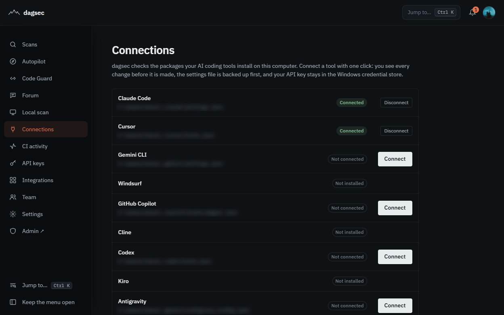
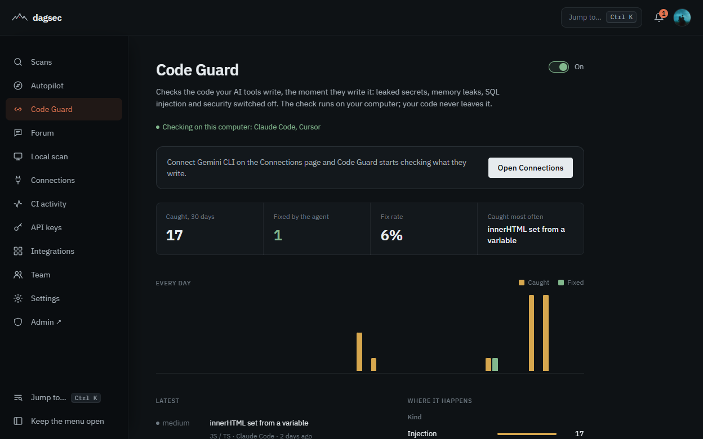
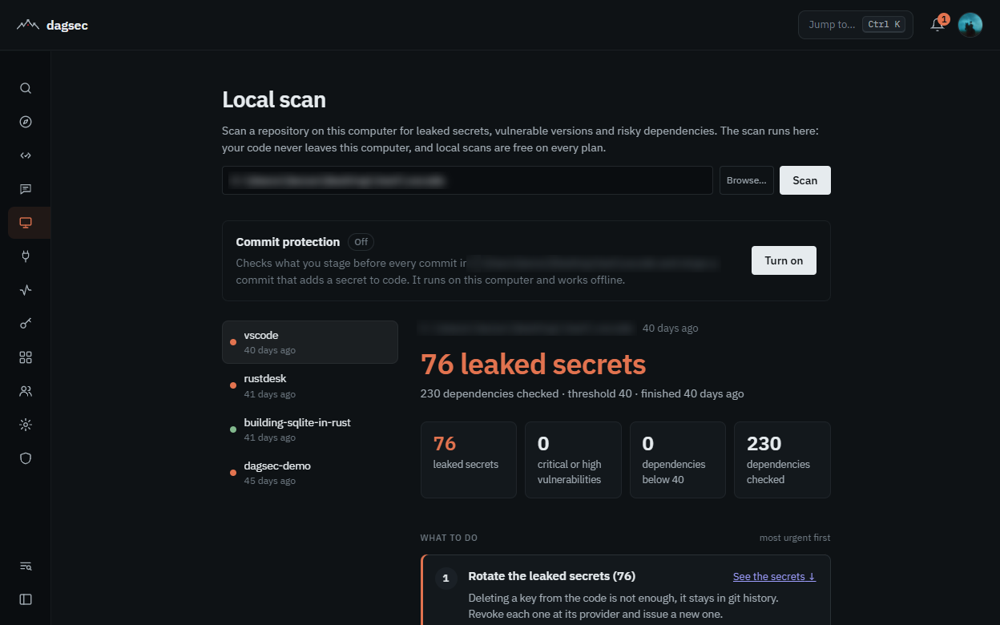
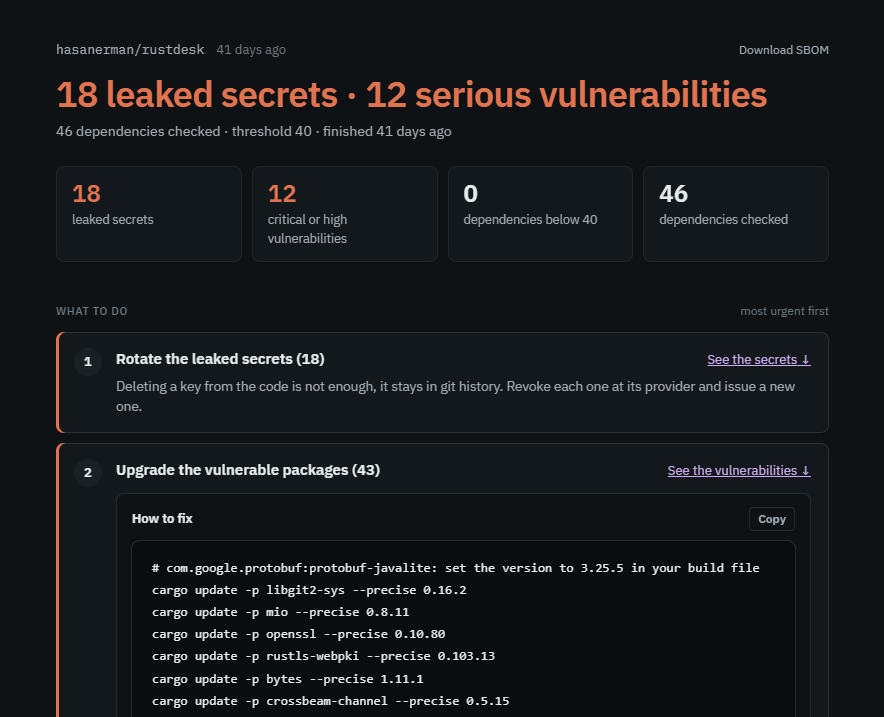

<p align="center">
  <a href="https://dagsec.net"></a>
</p>

<h1 align="center">dagsec desktop</h1>

<p align="center">
  Supply-chain security for the age of AI coding agents.<br>
  One app for Windows, macOS and Linux that keeps Claude Code, Cursor, Copilot and other AI tools from adding unsafe code and packages.
</p>

<p align="center">
  <a href="https://github.com/hasanerman/dagsec-desktop/releases/latest"></a>
  
  <a href="https://dagsec.net"></a>
</p>

---

## Download

| Platform | Installer |
|---|---|
| **Windows** 10 and 11 | [dagsec-setup.exe](https://github.com/hasanerman/dagsec-desktop/releases/latest/download/dagsec-setup.exe) |
| **macOS**, Apple silicon and Intel | [dagsec.dmg](https://github.com/hasanerman/dagsec-desktop/releases/latest/download/dagsec.dmg) |
| **Linux**: Debian, Ubuntu, Kali | [dagsec_amd64.deb](https://github.com/hasanerman/dagsec-desktop/releases/latest/download/dagsec_amd64.deb) |

The app updates itself: each release is signed, and installed apps check this repository for the next one.

---

## What it does

### Connect your AI tools in one click

Claude Code, Cursor, GitHub Copilot, Codex, Gemini CLI, Windsurf, Cline, Kiro and Antigravity. You see every change before it is made, the settings file is backed up first, and your API key stays in the system's credential store.



### Stop risky installs before they run

When an agent runs `npm install`, `pip install`, `cargo add` or `composer require`, dagsec checks the package first. Versions with known vulnerabilities and packages that don't exist (a common trap when agents invent names) are blocked, and the agent is told the safe version.

### Code Guard: check the code as it's written

Every file your agent writes is checked on your computer for leaked secrets, memory leaks, SQL injection, outdated runtimes and security switched off. The agent is asked to fix what it finds. Your code never leaves your machine.



### Local scans, free on every plan

Scan any repository on your computer for leaked secrets in its whole git history, vulnerable dependencies and risky packages. Commit protection stops a commit that adds a secret.



### A report that says what to do first

Every scan ends with the most urgent steps first, and the exact commands to fix them.



### Teams

Teams write rules every member's agent follows: commands to stop, files to protect, package versions to keep. Plans split the work into tasks agents can take, and a task is done only when its pull request passes dagsec and is merged.

---

## More dagsec

- **[Dashboard](https://app.dagsec.net)**: scans, teams, plans and the vulnerability forum
- **[GitHub Action](https://github.com/hasanerman/dagsec-action)**: a report on every pull request
- **[Claude Code plugin](https://github.com/hasanerman/dagsec-claude)**: install checks inside Claude Code
- **[Docs](https://docs.dagsec.net)**

## Say hello

This repository also holds a tiny Rust program that welcomes you and points to the right installer for your computer:

```bash
cargo run
```

---

<p align="center">Built with Rust and Tauri · <a href="https://dagsec.net">dagsec.net</a></p>
